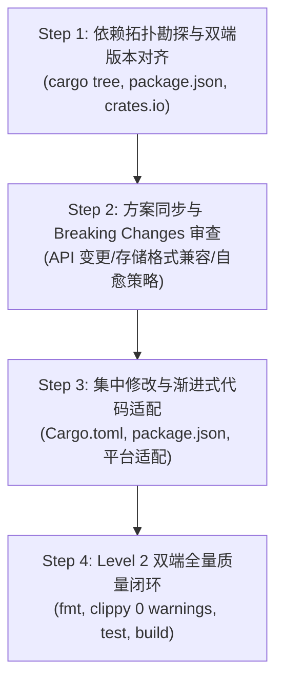

# Tauri 2 & Rust 依赖升级与双端协同规范 (Runbook)

本 Skill 用于指导 Agent 在 Tauri 2 + Rust + 前端项目中，执行规范、高效、无破坏性的全栈依赖升级与平台库版本统一。

---

## 1. 核心原则与能效红线

1. **禁止自动 Git Push**：
   - 严禁任何形式的自动 `git push`。
   - 升级验证通过后，仅限在本地执行规范的原子化 `git commit`（如 `build(deps): upgrade tauri to 2.12.2 and align windows-rs`）。
2. **Cargo.toml 最小扰动原则（极速能效）**：
   - 改动 `Cargo.toml` 会触发全量依赖元数据重新扫描（耗时约 1~3 分钟）。
   - **次版本/补丁更新**：优先使用 `cargo update -p <crate_name>`，避免无谓触碰 `Cargo.toml`。
   - **跨主版本/特性调整**：必须在方案中集中一次性规划好版本号与 features，一次性写入，严禁连续频繁碎改。
3. **两层分级验证流（0 warnings 零容忍）**：
   - 过程开发使用 **Level 1 极速流**（`cargo check` + 模块聚焦测试）。
   - 结束前必须通过 **Level 2 质量铁律**（`cargo fmt --check` + `cargo clippy -- -D warnings` + 双端全量测试 + `pnpm build`）。

---

## 2. 升级流程标准四部曲 (4-Step Standard Procedure)



### 第一步：依赖拓扑勘探与版本对齐 (Inspection)

1. **检测传递依赖冲突与双版本共存**：
   运行命令查看关键底层库是否存在版本分裂（例如应用用了老版本，Tauri 内核用了新版本）：
   ```powershell
   cargo tree -i <crate_name>
   # 示例：检查 windows-rs 版本归属
   cargo tree -i windows
   ```
2. **Tauri 2 双端生态版本对齐（Full-Stack Sync）**：
   - **Rust 端**：`tauri`, `tauri-build`, `tauri-plugin-*`。
   - **前端**：`@tauri-apps/api`, `@tauri-apps/cli`, `@tauri-apps/plugin-*`。
   - 必须确保 Rust 插件版本与前端 npm 插件版本保持次版本/补丁对齐。
3. **平台 crate 对齐准则（如 `windows-rs`）**：
   - Tauri 2 核心窗口引擎（`tao` / `wry`）内部强绑定了特定版本的 `windows` crate（如 0.62.2）。
   - 目标：将应用自身的 `Cargo.toml` 中 `windows` 版本升级至与 Tauri 内部一致，消除重复编译开销（避免编译两套庞大的 Win32 元数据）。

---

### 第二步：Breaking Changes 审查与兼容性防御 (Impact Analysis)

对于大版本升级（例如 `redb` v2 $\to$ v4，或 `windows` 0.58 $\to$ 0.62），必须制定以下防御措施：
1. **API 语法破坏性变更**：
   - 查看官方 release notes 或 docs.rs。
   - 示例（`redb` v4）：移除了 `TableDefinition<'static, K, V>` 的生命周期参数，变为 `TableDefinition<K, V>`。
   - 示例（`windows`）：句柄类型（`HWND`, `HDC`）转换、错误类型（`windows::core::Error`）处理。
2. **底层数据格式与存储防崩自愈（Self-Healing）**：
   - 嵌入式数据库升级通常伴随文件格式版本升级。
   - **关键防线**：在数据库打开/初始化入口处（如 `DictStore::open`），增加 `try-catch` 或错误捕获逻辑。若检测到底层文件格式不兼容或版本错误，必须优雅重置/备份并基于种子库重新初始化，**严禁导致桌面客户端启动 Crash**。

---

### 第三步：集中实施与渐进式适配 (Implementation)

1. **依赖集中声明**：
   - 更新 `src-tauri/Cargo.toml` 与根目录 `package.json`。
   - 运行前端安装：`pnpm install`。
2. **极速增量适配（Level 1）**：
   - 在 `src-tauri/` 运行 `cargo check` 查看编译错误。
   - 针对具体模块修复类型不匹配、方法签名变动。
   - 运行单模块极速单测验证逻辑（如 `cargo test core::dictionary::tests`）。
   - 在项目根目录运行 `pnpm exec tsc --noEmit` 校验前端类型。

---

### 第四步：阶段性落地与 Commit 前质量闭环 (Verification Gate)

完成所有代码适配后，必须严格按顺序执行以下质量闭环：

```powershell
# 1. Rust 代码格式统一 (无输出即为通过)
cd src-tauri
cargo fmt --check

# 2. 静态分析与代码异味清零 (CI 严格门禁，0 warnings 零容忍)
cargo clippy --all-targets -- -D warnings

# 3. 双端全量测试
cargo test
cd ..
pnpm test

# 4. 前端打包验证 (验证产物无超标、无打包破损)
pnpm build
```

---

## 3. 常见升级场景速查表

| 升级场景 | 推荐操作 | 核心关注点 |
| :--- | :--- | :--- |
| **小版本/补丁更新**<br/>(例: `serde 1.0.210 -> 1.0.215`) | `cargo update -p <crate>` | **不修改 Cargo.toml**，秒级完成，仅需 `cargo check`。 |
| **Tauri 2 框架升级**<br/>(例: `tauri 2.11 -> 2.12`) | 同步更新 `Cargo.toml` 与 `package.json` | 检查 `@tauri-apps/api` 与 `tauri` 版本对齐，查阅 Tauri changelog。 |
| **底层平台对齐**<br/>(例: `windows 0.58 -> 0.62`) | 更新 `windows` 版本并保留/追加 features | 运行 `cargo tree -i windows` 确认单版本收敛，检查 Win32 API 句柄。 |
| **关键数据库/解析器升级**<br/>(例: `redb 2 -> 4`) | 更新 `Cargo.toml` 并重构 Table接口 | **必须包含文件损坏/旧格式自愈防崩保护**，运行数据库读写单测。 |

---

## 4. 完成检查单 (Checklist)

- [ ] `Cargo.lock` 中无意外分裂的重复大版本依赖。
- [ ] 前端 `package.json` 与 Rust `Cargo.toml` 中 Tauri 插件版本一致。
- [ ] 针对 Breaking Change 有完备的向前兼容或自愈容错逻辑。
- [ ] `cargo fmt --check` 零告警。
- [ ] `cargo clippy --all-targets -- -D warnings` 零告警。
- [ ] 后端 `cargo test` 100% 通过。
- [ ] 前端 `pnpm test` 100% 通过。
- [ ] `pnpm build` 顺利产出且主包维持轻量。
- [ ] **严守安全红线：未调用 `git push`**。
