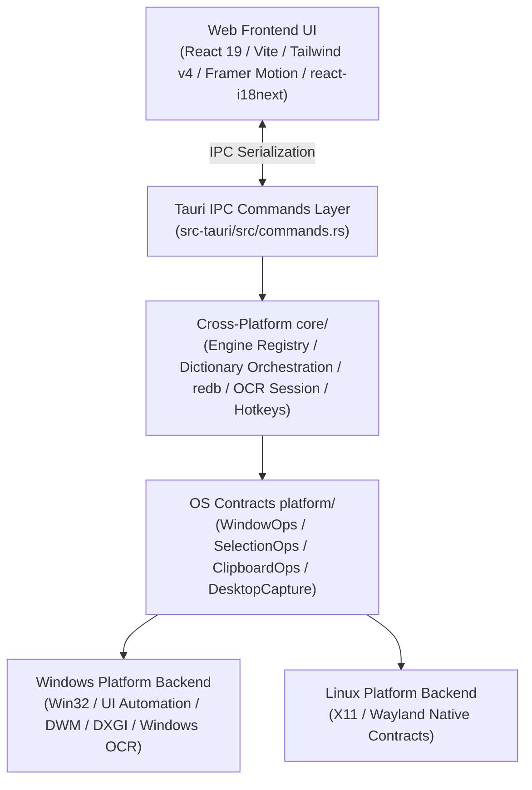

# TransPortal

<p align="center">
  
</p>

<p align="center">
  <strong>High-performance, lightweight desktop AI translation & dictionary workspace powered by Tauri v2, Rust, and React</strong>
</p>

<p align="center">
  <strong>English</strong> | <a href="README_zh.md">简体中文</a>
</p>

<p align="center">
  
  
  
  
  
  
</p>

---

## 🌟 Key Highlights & Design Philosophy

TransPortal is engineered for high-frequency reading, software engineering, and multi-lingual workflows. It eliminates the heavy startup lag and massive RAM overhead typical of conventional Electron translation tools by decoupling user interaction into **"Transient Instant Popups"** and **"Full Deep Workspaces"**:

- ⚡ **Transient HUD Popups (Instant Dismissal)**: Borderless, clean floating HUD positioned naturally near the cursor with smart screen edge boundary clamping. Automatically dismisses upon losing focus (blur) or pressing `Esc` within milliseconds, ensuring zero desktop disruption.
- 🎯 **Global Text Selection & In-Place Replacement**: Uses Windows native UI Automation `TextPattern` to extract selected text across arbitrary applications (with silent clipboard fallback). Supports silent in-place overwrite of selected source text with target translations.
- 🔍 **Local Offline & Dual-Engine Screen OCR**: Built-in native snipping tool with zero external dependencies. Integrates local **ONNX PP-OCRv5 FP32** inference (offline high-accuracy Chinese/English recognition without requiring Python or GPU drivers). Supports side-by-side comparative reading with word drilldown, in-place picture text overlay, snip & web search, and silent background OCR to clipboard.
- 🔊 **Offline Neural TTS (Kokoro ONNX)**: Integrated INT8 quantized neural voice synthesis engine (~**90.6 MB** asset bundle), delivering offline English & Chinese speech with natural prosody and dynamic subword compound phonemization fallback.
- 📚 **Enriched Offline Dictionary & Online Supplements**: The default ECCEDICT download enriches the ~770k-entry base with UK/US phonetics and exam tags before importing into `redb`. Enabled local data supplements online word cards with tags, word forms and corpus ranks while keeping meanings attributed. Translation also supports Bing, Google, Youdao, Tencent and custom OpenAI-compatible streaming endpoints with **auto-fetch model lists**.
- 🛡️ **Subtle Dashed Affordance & Full Internationalization (i18n)**: Replaces cluttered `?` icons with elegant subtle dashed underlines (Dashed Affordance). Hovering over any title instantly unveils a sleek frosted glass tooltip card with rich explanations. Ships with 100% clean, non-bracketed English and Simplified Chinese localization.
- 📊 **Hardware-Accelerated Capture Diagnostics**: Multi-tier screen capture probe (DXGI / WGC Window / WGC Monitor / GDI) with latency measurement and instant Markdown report generation.
- 🍃 **Ultra-Low Memory Footprint**: Native Rust core resident memory remains **~30-60 MB** (70%+ lower RAM usage than traditional Electron apps), complemented by an automated dual-stage memory trimmer upon window idle.

---

## 🚀 Interaction Flow & Modes

```
+-------------------------------------------------------------------------------+
|                                  TransPortal                                  |
+-------------------------------------------------------------------------------+
|  [Selection Lookup]     Alt+Q        Select text on screen to show popup      |
|  [In-Place Replace]     Alt+Z        Silently overwrite selection with target |
|  [Double Copy]          Ctrl+C+C     Tap C twice within 0.5s without conflict |
|  [Ink Gesture Key]      Modifier     Hold key while dragging mouse to lookup  |
+-------------------------------------------------------------------------------+
|  [Side-by-Side OCR]     Alt+Shift+X  Snip region for side-by-side word lookup |
|  [In-Place Picture]     Alt+S        Snip image and overlay text in-place     |
|  [Snip & Web Search]    Alt+Shift+C  Snip text to recognize & search in web   |
|  [Silent OCR]           Alt+Shift+S  Recognize silently to clipboard          |
|  [Input Workspace]      Alt+Space    Open centered input box & search history |
+-------------------------------------------------------------------------------+
```

---

## 🛠️ System Architecture

TransPortal adheres to a strict separation between **`core` (cross-platform business logic)** and **`platform` (OS contracts & implementations)**:



- **Architectural Invariants**: The `core/` module contains zero `cfg(target_os)` checks and depends solely on generic `platform/` traits. Validated continuously in CI via `scripts/check-architecture.sh`.
- **Window Singleton Reuse**: Transient overlay and OCR snipping windows are pre-warmed singletons (`show` / `hide` / `set_position`), preventing Chromium context recreation and eliminating blank frame flashes.

---

## 💻 Quick Start

### Prerequisites
- **Node.js** >= 18 and **pnpm**
- **Rust** (stable toolchain)
- **Operating System**:
  - Windows 10 (version 2004+) or Windows 11 (WebView2 pre-installed)
  - Linux (Requires system packages: `pkg-config libssl-dev libdbus-1-dev libgtk-3-dev libwebkit2gtk-4.1-dev libayatana-appindicator3-dev librsvg2-dev libxdo-dev`)

### Development Setup
```bash
# 1. Clone repository
git clone https://github.com/your-username/TransPortal.git
cd TransPortal

# 2. Install frontend dependencies
pnpm install

# 3. Prepare offline OCR models (Downloads and verifies PP-OCRv5 ONNX model)
pnpm ocr:prepare

# 4. Start local development with Vite + Tauri hot reload
pnpm tauri dev
```

### Verification & Quality Gates
The repository enforces a dual-tier quality gate:
```bash
# Frontend static check & unit tests
pnpm exec tsc --noEmit                          # TypeScript check (100% clean)
pnpm test                                       # Vitest suite (96 tests passing)

cd src-tauri
cargo check                                     # Fast backend syntax verification
cargo test platform::placement::tests           # Placement algorithm tests
cargo clippy --all-targets -- -D warnings        # Strict 0-warning lint
bash ../scripts/check-architecture.sh           # Core/platform architecture boundary
```

### Production Build
```bash
# Build desktop installer with verified SHA-256 integrity
pnpm build:release
```
Packaged installers are generated in `src-tauri/target/release/bundle/nsis/` (Windows) and `bundle/{deb,rpm,appimage}/` (Linux).

---

## ⌨️ Default Shortcuts Cheat Sheet

| Action | Default Shortcut | Description |
| :--- | :--- | :--- |
| **Selection Lookup** | `Alt + Q` | Trigger transient HUD popup on selected text |
| **In-Place Replace** | `Alt + Z` | Silently overwrite selected source text with target translation |
| **Double Copy** | `Ctrl + C + C` | Press C twice within 0.5s to trigger translation without stealing normal copy |
| **Side-by-Side OCR** | `Alt + Shift + X` | Snip screen area for dual-column view with word drilldown |
| **In-Place Image Translate** | `Alt + S` | Snip screen image and overlay translations on detected text |
| **Snip & Search** | `Alt + Shift + C` | Snip text to recognize and launch search in default browser |
| **Silent OCR** | `Alt + Shift + S` | Recognize text in background directly into clipboard |
| **Input Workspace** | `Alt + Space` | Open centered floating input box |
| **In-Window Navigation** | `Tab` / `Esc` / `Ctrl+Shift+T` | Toggle original view / Dismiss window / Pin on top |

*Note: All shortcuts can be customized or restored to defaults in Settings -> Shortcuts & Gestures (active shortcuts are suppressed during recording to prevent accidental triggers).*

---

## 📖 Documentation

- 📖 [User Guide](docs/USER_GUIDE.md)
- 🧠 [Local OCR Engine & Benchmarks](docs/OCR.md)
- 🛡️ [Binary Integrity & SHA-256 Self-Checks](docs/STARTUP_CHECKS.md)

---

## 📄 License

This project is open-sourced under the [MIT License](LICENSE).
