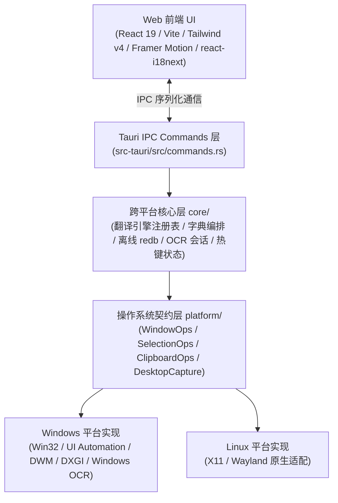

# TransPortal（轻量传送门）

<p align="center">
  
</p>

<p align="center">
  <strong>基于 Tauri v2 + Rust + React 构建的高性能轻量级桌面 AI 翻译与辅助阅读工作台</strong>
</p>

<p align="center">
  <a href="README.md">English</a> | <strong>简体中文</strong>
</p>

<p align="center">
  
  
  
  
  
  
</p>

---

## 🌟 核心特色与设计哲学

TransPortal 专为高频阅读、代码查阅与办公协作场景打造，彻底摆脱传统 Electron 工具“内存臃肿、启动迟钝”的通病，确立**“瞬态即用即走，常态深度交互”**的人机交互分层：

- ⚡ **毫秒级瞬态气泡（HUD Quick Popup）**：无边框无标题栏，贴近光标弹出并带屏幕边界智能钳制。失焦或按 `Esc` 毫秒级即时隐退，绝不干扰主工作区。
- 🎯 **全局智能划词与原地替换**：优先通过 Windows 原生 UI Automation `TextPattern` 穿透捕获选区（失败自动平滑降级剪贴板）；支持将译文极速静默覆写回原选区输入框。
- 🔍 **本地离线与双模 OCR 识别**：内置低延迟原生框选器，集成 **ONNX PP-OCRv5 FP32** 纯本地推理引擎（中英混合离线高精度识别，无需配置 Python 环境或独立显卡）；支持图文双栏对照、原图覆盖译文、截图文字搜索与静默提取入剪贴板。
- 🔊 **纯离线 Kokoro ONNX 语音合成 (TTS)**：内置 INT8 量化神经语音模型（仅约 **90.6 MB** 资源包），支持离线生成自然流畅的高品质英音与美音发音，内置动态复合词音素分解与智能 fallback，查词即听纯正音色。
- 📚 **富化离线词库与在线补充**：默认将约 77 万条 ECCEDICT 基础词库与英美音标、考试标签增强数据合并后导入 `redb`。本地数据可补充在线词卡的标签、词形与词频，释义来源保持独立；同时兼容 Bing、Google、有道、腾讯及自定义 OpenAI 兼容流式接口，支持**一键获取模型列表（Auto Fetch Models）**。
- 🛡️ **微虚线交互与全量国际化 (i18n)**：界面杜绝冗余的 `?` 问号噪点与中英双拼括号，采用现代操作系统的微虚线暗线设计（Dashed Affordance），鼠标悬停（Hover）即优雅弹出磨砂玻璃说明；支持简体中文与英文无感即时切换。
- 📊 **多管线捕获探针与截屏诊断**：内置多层捕获探针（DXGI / WGC Window / WGC Monitor / GDI），根据前台窗口属性自动调度最高效截屏通道，支持一键生成并复制全链路诊断报告。
- 🍃 **精巧物理内存管理**：Rust 核心常驻物理内存仅需 **~30-60 MB**（相较传统 Electron 架构内存降低 70%+），内置后台双阶段物理内存深度修剪机制。

---

## 🚀 核心功能与快捷键映射图解

```
+-------------------------------------------------------------------------------+
|                                  TransPortal                                  |
+-------------------------------------------------------------------------------+
|  [划词查询]          Alt+Q        选中屏幕任意文本秒出瞬态查词浮层             |
|  [原地替换]          Alt+Z        划选文字后静默用目标译文直接覆盖             |
|  [双击复制]          Ctrl+C+C     连按两次 C 触发，普通复制不被抢占           |
|  [落墨手势]          修饰单键     按住单键划选鼠标，松开按键瞬间触发           |
+-------------------------------------------------------------------------------+
|  [截图对照]          Alt+Shift+X  框选屏幕区域，原图与译文双栏对照点词查词     |
|  [原图翻译]          Alt+S        框选屏幕图像，原文字位置覆盖呈现译文         |
|  [截图搜索]          Alt+Shift+C  框选文字提取并自动调用浏览器默认引擎搜索     |
|  [静默 OCR]          Alt+Shift+S  后台识别屏幕文字直接存入剪贴板               |
|  [输入翻译]          Alt+Space    唤起居中工作台，手动输入与历史回顾           |
+-------------------------------------------------------------------------------+
```

---

## 🛠️ 技术架构

TransPortal 采用严格的 **`core`（跨平台业务应用层）+ `platform`（OS 契约与适配层）** 分离架构：



- **架构约束守则**：`core/` 严禁包含操作系统特定宏（`cfg(target_os)`）与原生 API 依赖，所有跨平台能力均通过 `platform/` 抽象契约提供，并通过自动化架构检查脚本（`scripts/check-architecture.sh`）持续死守。
- **窗口单例与状态同步**：瞬态浮窗与截图遮罩采用单例预热生命周期（`show` / `hide` / `set_position`），避免反复重建 WebView2 造成的白屏闪烁与内存泄漏；底层 Win32 API 与 Tao 窗口焦点保持强一致性同步唤醒。

---

## 💻 快速开始

### 运行环境准备
- **Node.js** >= 18 + **pnpm**
- **Rust** (stable toolchain)
- **操作系统**：
  - Windows 10 (2004+) / Windows 11（系统自带 WebView2）
  - Linux（安装基本编译包：`pkg-config libssl-dev libdbus-1-dev libgtk-3-dev libwebkit2gtk-4.1-dev libayatana-appindicator3-dev librsvg2-dev libxdo-dev`）

### 本地开发与调试
```bash
# 1. 克隆代码仓库
git clone https://github.com/your-username/TransPortal.git
cd TransPortal

# 2. 安装前端依赖
pnpm install

# 3. 准备 OCR 离线模型资源（下载、校验并暂存 PP-OCRv5 模型）
pnpm ocr:prepare

# 4. 启动本地开发热重载（Vite + Tauri）
pnpm tauri dev
```

### 验证与质量闭环
项目遵循分级质量门禁体系：
```bash
# 静态检查与单元测试
pnpm exec tsc --noEmit                          # 前端类型检查 (100% 绿色)
pnpm test                                       # 前端单元测试 (96 个用例全过)

cd src-tauri
cargo check                                     # 后端极速语法检查
cargo test platform::placement::tests           # 核心放置逻辑单元测试
cargo clippy --all-targets -- -D warnings        # 零 warning 严格静态扫描
bash ../scripts/check-architecture.sh           # core/platform 分层架构扫描
```

### 打包发布构建
```bash
# 构建生产环境安装包（自动集成并校验 ONNX 资源与 SHA-256）
pnpm build:release
```
编译生成的安装包位于 `src-tauri/target/release/bundle/nsis/`（Windows）及 `bundle/{deb,rpm,appimage}/`（Linux）。

---

## ⌨️ 常用快捷键一览

| 操作场景 | 推荐默认快捷键 | 功能描述 |
| :--- | :--- | :--- |
| **划词取词** | `Alt + Q` | 选中文本呼出瞬态查词浮层 |
| **原地替换** | `Alt + Z` | 静默将选中文本原地替换为译文 |
| **双击复制** | `Ctrl + C + C` | 0.5s 内连按两次 C 触发划词翻译，普通复制不被抢占 |
| **截图对照** | `Alt + Shift + X` | 框选屏幕进行图文双栏对照与点词下钻 |
| **原图翻译** | `Alt + S` | 框选屏幕在原始图片文字位置覆盖译文 |
| **截图搜索** | `Alt + Shift + C` | 框选提取文本并直接唤起浏览器默认搜索引擎进行检索 |
| **静默 OCR** | `Alt + Shift + S` | 截图文字极速识别并直接存入剪贴板，零视觉干扰 |
| **输入工作台** | `Alt + Space` | 唤起居中主输入工作台 |
| **浮层内置控制** | `Tab` / `Esc` / `Ctrl+Shift+T` | 透视原图切换 / 退出或隐藏 / 浮层固定置顶 |

*注：所有全局快捷键均可在「偏好设置 -> 快捷键与手势」中自由录制与一键恢复默认（录制过程中已实现全局热键监听阻断，防止按压触发原有快捷键）。*

---

## 📖 相关文档

- 📖 [用户使用指南 (User Guide)](docs/USER_GUIDE.md)
- 🧠 [本地 OCR 模型说明与基准测试](docs/OCR.md)
- 🛡️ [安装包 SHA-256 启动完整性自检](docs/STARTUP_CHECKS.md)

---

## 📄 开源许可证

本项目基于 [MIT License](LICENSE) 开源。
